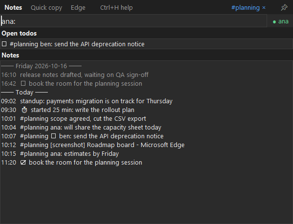

# quickpick

[](https://github.com/mlessley/quickpick/actions/workflows/ci.yml)

A personal Windows productivity tool: a hotkey-summoned popup for capturing notes and screenshots into a chronological digest, copying saved strings, and opening bookmarks.



## Why this exists

I wanted one keystroke for the small things I do all day (paste a saved string, open a link, jot down a quick note) without leaving the keyboard or adopting another app. The constraints shaped it more than the features did:

- **A managed Windows laptop.** No admin rights, and nothing that watches the keyboard: global hotkeys go through `RegisterHotKey`, which only sees its own key combinations ([ADR-0001](./docs/adr/0001-registerhotkey-not-keyboard-hooking.md)).
- **Keyboard first.** One summon hotkey, modes cycled inside the popup ([ADR-0003](./docs/adr/0003-single-summon-hotkey-with-in-app-mode-cycling.md)).
- **Plain files I own.** Notes are a JSON Lines file per day, added to in order and readable in any editor; nothing goes to a cloud service.
- **Use what's already installed.** Edge's own bookmarks and history, GreenShot for screenshots, Outlook and Teams as they are.

It's built in Python with Tk and pywin32. [CONTEXT.md](./CONTEXT.md) is the glossary of its terms and [docs/adr](./docs/adr) records the key design decisions. It was built with [Claude Code](https://claude.com/claude-code), working from a glossary, specs and tickets, test first.

## Running

Requires Windows and [uv](https://docs.astral.sh/uv/).

```
uv sync
uv run quickpick
```

Quickpick stays running in that console. At startup the popup opens centred on the screen with the mouse, on a splash showing today's digest so far and every hotkey (generated from your config). Up/Down, PageUp/PageDown and the mouse wheel scroll it, section by section (anywhere, the popup, each mode, commands, apps, settings); typing, or any other popup key, goes straight on from the splash; **Ctrl+H** brings it back at any time. Press **Ctrl+Alt+Space** from any window to open the popup and again to close it; **Ctrl+C** in the console, or **Ctrl+Q** twice in the popup, quits.

**Without a console:** `uv run quickpick-shortcuts` adds Quickpick to the Start menu and starts it whenever you sign in to Windows (`uv run quickpick-shortcuts --remove` takes both away). The shortcuts carry Quickpick's icon, a lightning bolt (`src/quickpick/quickpick.ico`, drawn by `uv run python -m quickpick.icon`); run `quickpick-shortcuts` again to update shortcuts made by an earlier version. The shortcuts run `uvw run --project <this folder> python -m quickpick.gui`, so Quickpick runs from this checkout with no console window, and uv keeps its packages in sync on each start. (Not the `quickpick-gui` script: it runs through the venv's `pythonw.exe`, which uv makes a console launcher, so a console window opens beside it.) Quit it with **Ctrl+Q** twice in the popup. Anything that stops it starting (a bad `config.json`, a hotkey that's already taken, e.g. by a copy already running) is shown in a message box, and its output goes to `~/.quickpick-data/quickpick.log`.

The popup has three modes, **Notes**, **Stash** and **Bookmarks**. Click a mode's name, or press **Ctrl+N**, **Ctrl+S** or **Ctrl+B**, to go to it; **Ctrl+Tab** / **Ctrl+Shift+Tab** cycle through them. The popup reopens in whichever mode you used last. Drag the bar along the top to move the popup; it reopens where you left it until Quickpick restarts, unless that's now mostly off screen (say, on a monitor you've since unplugged), when it reopens centred on the monitor under the mouse. A coloured edge shows the popup has your keystrokes: blue, or amber while pinned. The bar along the bottom lists the keys that work where you are, and for a few seconds after you do something, says what happened (`Note saved`, `Copied "vpn"`, `Timer set: 25 min, write spec`).

- **Notes**: type a note and press **Enter** to add it to today's digest; the popup stays open and the list below shows today's notes, newest at the bottom, under the past week's (greyed) for context. **PageUp/PageDown** scroll it. **Ctrl+L** clears it, like a terminal: everything so far moves up out of view behind a `cleared 10:42` marker, and PageUp scrolls back to it (it lasts until the end of the day or a restart, and never changes the digest). **Ctrl+F** turns the query box into a search of every day's notes, todos and screenshots (🔍 at its left): every word typed must match, in any order, in the text, tags or labels, and the newest 200 matches are listed with their dates. **Enter** opens the selected one in the viewer, highlighted; **Ctrl+Enter** copies its text; **Esc** goes back to writing. **Ctrl+E** opens today's digest file in Notepad, to fix a typo or remove an entry by hand (see [Editing the digest by hand](#editing-the-digest-by-hand)). **F2** opens the full digest in the [viewer](#viewer), starting it inside Quickpick if it isn't already running. If the viewer is already open (as the active tab of an Edge or Chrome window), that window is brought forward and reloaded instead of opening another. **Ctrl+N** from any other mode jumps to Notes; pressed in Notes, it opens the viewer like F2 (so Ctrl+N twice opens the viewer from anywhere). **Ctrl+U** or a double-click on a note or todo opens the first web address in it, on any of its lines, in a new browser window. A note you haven't saved yet is still there the next time the popup opens, however it was closed. **Ctrl+I** adds the PNG you just downloaded (say, from Copilot's *Download PNG*) as an image entry: the newest `.png` in your Downloads folder from the last hour is moved into the screenshot folder, named like a screenshot, and logged with the tags that are on.
  - **Several lines**: **Shift+Enter** opens the query box up to several lines (in Stash too); there, **Enter** starts a new line and **Ctrl+Enter** saves. **Esc** goes back to one line, keeping what you wrote. The popup's lists show a long note's first line and how many more it has; the viewer shows it all.
  - **Todos**: a note starting with `[]` (e.g. `[] renew the parking permit`) is a todo. Open todos, from any day, are listed above the notes until ticked off: **Up/Down** select one, **Ctrl+D** ticks it off. Click the **Open todos** heading, or press **Ctrl+Up** / **Ctrl+Down**, to collapse the list to just its heading and count, or expand it again; it stays that way until Quickpick restarts. The splash shows how many are open.
  - **Tags**: type `#project-x` alone and press **Enter** to switch that tag on (inventing it if it's new); the same again switches it off. Typing `#` lists your recent tags. Active tags show at the top right (click one to switch it off) and label every note, todo, screenshot and timer entry until the popup closes, so pin it (below) to keep a tag on for a while. In the viewer, click a tag to see everything with it.
  - **Labels**: start a note or todo with a word, a colon and a space, e.g. `idea: weekly summary`, `book: Deep Work` or `url: https://…`, to label just that line. In a note of several lines, any line can start with its own label. A line starting with `...` (or `…`) continues the label of the line before it, across notes too, until a line without a label or `...`: `idea: weekly summary` then `... grouped by tag` are both labelled `idea`. Type **`:`** at the start of a line to list every label you've used, most recent first; **Enter** starts the line with the chosen one. In the viewer each label is a link to every entry with it, from any day. Older notes written this way are labelled too. While you type one (on the cursor's line, in a note of several lines), a badge at the right of the query box shows it in green if you've used it before (`idea (continued)` on a `...` line), or in amber as a new label, with the label it's probably a typo of (e.g. `new label: ideas · idea?`).
- **Stash**: strings to copy, in two lists. **Enter** or double-click copies the selected value; **Ctrl+U** opens it in a new browser window instead, if it's a web address.
  - **Saved**: your own list, `quick-copy.txt`. **F2** opens it in Notepad; changes show up the next time the popup opens.
  - **Scratch**: a list for later. Type or paste text and press **Ctrl+Enter** to add it at the top, labelled by its start (`SELECT id, name ⏎ FROM…  +30 chars · 3 lines`). Write `vpn ~!~ 10.0.0.1` to give it your own label, and start with `*` (`*token ~!~ abc123`) to hide the value, which then shows only as its label, size and time (`token · masked · 6 chars · 14:05`); a label already in use asks you to press Ctrl+Enter again. Values can span several lines (**Shift+Enter**, below). **Ctrl+Delete** removes the selected entry, and only the newest 100 are kept. **F2** with a scratch entry selected opens its file, `stash-scratch.jsonl`.
- **Bookmarks**: lists your Edge bookmarks and, below them, your most recent history (up to 100 matches, each with when you last visited it: the time today, the weekday this week, the date before that), both filtered by the same query. **Tab** / **Shift+Tab** move the selection between the two lists; **Enter** or double-click opens the selected item in a new browser window.

### Screenshots

**Ctrl+Alt+S** (works whether or not the popup is open) takes a screenshot through [GreenShot](https://getgreenshot.org/): Quickpick closes the popup, triggers GreenShot's region capture, and adds a `[screenshot]` entry to today's digest with the title of the window you were in and the saved image. The image file is renamed to match, e.g. `2026-10-18 12_02_38-Untitled - Paint.png`, since GreenShot's own window title can be out of date. Quickpick reads GreenShot's capture hotkey and save folder from its own settings. In GreenShot's Preferences:

- **Destination:** untick "Select destination dynamically"; tick "Save directly (using preferred file output settings)", plus "Copy to clipboard" if you want the image to paste straight away.
- **Output:** leave "Copy file path to clipboard every time an image is saved" unticked; the path it copies is GreenShot's name, from before Quickpick renames the file.

Captures taken with GreenShot's own hotkey (outside Quickpick) are untouched: no digest entry, and GreenShot's naming.

**Commands** start the query with `/` and work in every mode: **`/g home`** searches your repo shortcuts (the launcher store; **F2** edits it), and **`/j`** opens Jira: `/j 123` is issue 123 in your default project, `/j ABC-42` that issue, `/j some words` a Jira text search, and a bare `/j` the default project; a pasted Jira address opens as it is. Text after the issue or address is its title (`/j 123 login fails on SSO`). Below the first row, `/j` lists what you've opened before, newest first (the last 50), filtered by the issue or text typed; opening one moves it back to the top. **Ctrl+Delete** or **Ctrl+D** removes the selected one, and **F2** opens the list, `jira.txt`, in Notepad, one `title ~!~ address` per line: retitle a line there, or start it with `!` to pin it (📌) above the rest for good, like a sprint board or backlog. Text searches aren't remembered. Type **`/`** to list the commands; **Enter** on one fills it in (`/g `). A line starting with `/` that isn't a command, like `/etc/hosts fixed`, stays a note (or a search).

Wherever Quickpick opens a URL, **Enter** uses your default browser (Edge unless configured) and **Ctrl+Enter** uses the other one (Chrome / Edge).

In Stash and Bookmarks: type to filter, **Up/Down** to move. **Esc** closes the popup in every mode.

**Focus timer:** **`/t 25 write spec`** starts a 25-minute timer (one at a time); a bare **`/t`** shows it, and **Enter** cancels it. The time left shows at the top right; when it runs out, a notice pops up in the bottom-right corner with a sound. Starting, finishing and cancelling are logged to the digest.

**Pin:** unpinned, the popup closes as soon as you click or switch into another window. **Ctrl+P** (or the 📌 at the top right) pins it: it stays open and on top of other windows, copying, opening links, switching apps and the viewer no longer close it, the summon hotkey only brings it forward, and after a screenshot it comes back. Only **Esc** closes it.

**App switching:** in any mode, **Ctrl+O** brings Outlook to the front and **Ctrl+T** Teams (restoring them if minimized) and hides the popup. It switches to the app's most recently used window and never starts the app: if it has no open window (not running, or closed to the tray), the popup says so. Add more apps or change the keys with `apps` in `config.json`.

### Viewer

```
uv run quickpick-viewer
```

Opens the digest in your browser as a log: notes and screenshots in time order, oldest at the top, opening scrolled to the newest at the bottom. It's served locally at `http://127.0.0.1:8765/`. It shows the last 30 days; the bar at the top loads 30 more days at a time, or everything (load everything before searching all of history with Ctrl+F). Reload the page to see new entries. Notes show a little markdown: `` `code` ``, `**bold**`, `*italic*`, `#` headings, `-` bullets and ```` ``` ```` fenced blocks, and web addresses are links. Anything else, HTML included, shows as typed; a `mermaid` block shows as code, not a diagram. **Edit in GreenShot** under a screenshot opens it in GreenShot's editor, and **Show in folder** opens its folder with the image selected. **Edit in Notepad** beside each day's heading opens that day's digest file. **Ctrl+C** in the console stops the viewer; it runs independently of the popup. You rarely need to start it this way: **F2** in notes mode starts the same viewer inside Quickpick on first use (it stops when Quickpick quits), or just opens the page if a standalone viewer is already running.

Data lives in `~/.quickpick-data/`:

- `quick-copy.txt`: the stash, one `key~!~value` entry per line; prefix the key with `*` to hide its value in the list. Pass a different path as the first argument to use another store.
- `stash-scratch.jsonl`: the stash's scratch list, one JSON entry per line, newest first; Quickpick rewrites it as entries come and go.
- `launcher.txt`: the `g:` launcher store, one `key~!~url` entry per line (e.g. `quickpick~!~https://github.com/mlessley/quickpick`).
- `digest/YYYY-MM-DD.jsonl`: one file per day of notes and screenshots, one JSON entry per line. Screenshot entries store the image's full path, so if you move images, update those paths too.
- `screenshots/`: a suggested home for GreenShot's captures. Set it as GreenShot's storage location (Preferences, Output); Quickpick follows whatever folder GreenShot uses.
- `config.json` (optional): **Ctrl+,** in the popup opens it in Notepad, first creating it with sample entries if there isn't one, and otherwise keeping the version before your edit as `config.json.bak`. It's read at startup: **Ctrl+R** restarts Quickpick to apply your changes, the same way it was started (from a console, the new one opens in a console of its own). If the config has a mistake, Ctrl+R says what it is and keeps the running Quickpick instead.
  - `summon_hotkey`: e.g. `"ctrl+shift+q"`. Modifiers are `ctrl`, `alt`, `shift`, `win`. Default `"ctrl+alt+space"`.
  - `screenshot_hotkey`: default `"ctrl+alt+s"`.
  - `greenshot_hotkey` / `screenshot_dir`: override the capture hotkey and save folder otherwise read from GreenShot's settings.
  - `browser`: `"edge"` (default) or `"chrome"`; the browser Enter opens URLs in. Ctrl+Enter uses the other.
  - `theme`: `"dark"` (default) or `"light"`, for both the popup and the viewer.
  - `jira_base_url` / `jira_default_project`: your Jira site (e.g. `"https://yourco.atlassian.net"`) and the project `/j 123` resolves against. The built-in defaults are placeholders.
  - `greenshot_exe`: GreenShot's executable, used by the viewer's Edit button. Default: the per-user install under `%LOCALAPPDATA%\Programs\Greenshot`.
  - `viewer_port`: default `8765`.
  - `stash_scratch_limit`: how many entries the stash's scratch list keeps, newest first. Default `100`.
  - `edge_profile`: the Edge profile folder whose bookmarks and history to list, e.g. `"Profile 1"`. Default `"Default"`.
  - `apps`: the popup's app-switch keys, each `{"key": ..., "name": ..., "program": ..., "title": ...}`. `program` is the executable's file name (any case); the optional `title` keeps only windows whose title contains it. Keys are Ctrl and/or Alt plus a letter or digit, or an F-key; the popup's own keys (Ctrl+N/S/B/H/P/D/Q/L/E, Ctrl+A/C/V/X/Z, F2) are refused. A list here replaces the default, which is:
    ```json
    "apps": [
      {"key": "ctrl+o", "name": "Outlook", "program": "OUTLOOK.EXE"},
      {"key": "ctrl+t", "name": "Teams", "program": "ms-teams.exe"}
    ]
    ```
  - `searches`: your own web-search commands, none by default. Each is `{"command": ..., "name": ..., "url": ...}`, where `url` has `{query}` where the typed text goes; `/p jane doe` then opens it with `jane%20doe` in that place (**Ctrl+Enter** for the other browser). Commands are letters or digits, and `g`, `j` and `t` are taken. For example:
    ```json
    "searches": [
      {"command": "p", "name": "People", "url": "https://people.example.com/search?query={query}"},
      {"command": "d", "name": "Dictionary", "url": "https://www.merriam-webster.com/dictionary/{query}"}
    ]
    ```

### Editing the digest by hand

Each day is a file in `~/.quickpick-data/digest/`, one JSON entry per line, oldest first. **Ctrl+E** in Notes (or **Edit in Notepad** in the viewer) opens it in Notepad. Fix a typo by editing the `"text"`. To remove an entry, replace its whole line with `{}` rather than deleting the line: ticked-off todos point at their todo by its position in the day's file, and `{}` keeps every position in place. A line that can't be read is skipped and flagged (`line 7 of 2026-10-20.jsonl couldn't be read`) in both the popup and the viewer, so a slip is easy to find. Removing a screenshot's line leaves its image in the screenshots folder; **Show in folder** in the viewer finds it.

## License

[MIT](./LICENSE)
